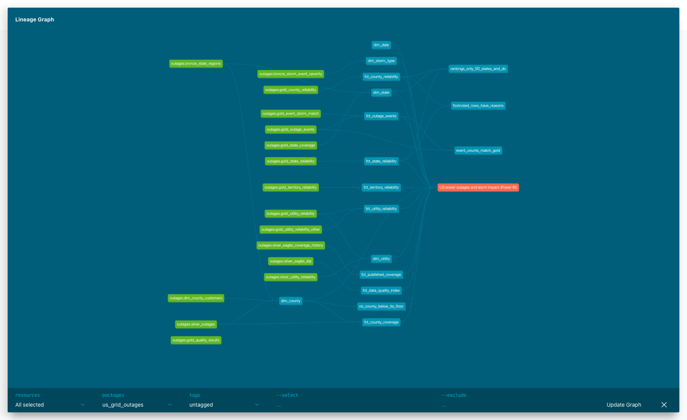
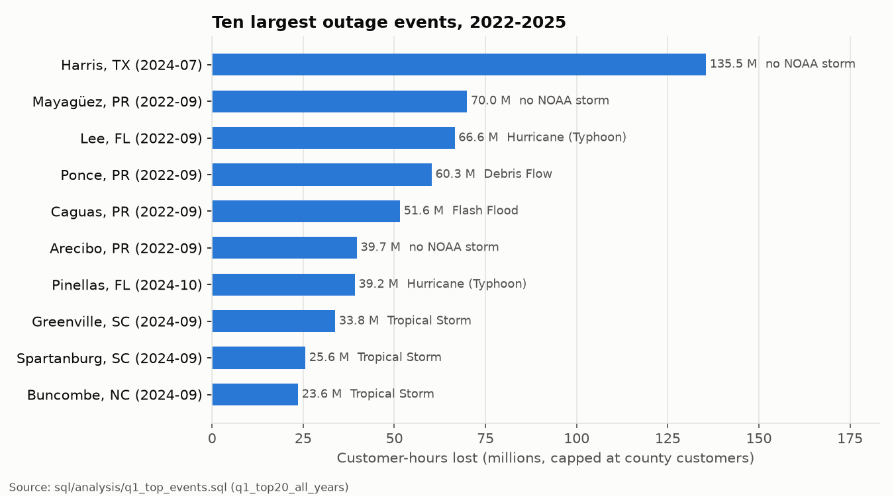

# US Power Outages & Storm Impact

## Overview

## Questions I Answer

## Data Sources

### Exported data

I publish the dbt marts for Power BI (D70). The small tables are committed as CSV in
[`data/gold_exports/summary/`](data/gold_exports/summary/). The outage events table is too large
for git and is attached to a GitHub Release:
- Release: [data-2026-11-23](https://github.com/Deva9102/us-grid-outage-analytics/releases/tag/data-2026-11-23)
- Download: [fct_outage_events.parquet](https://github.com/Deva9102/us-grid-outage-analytics/releases/download/data-2026-11-23/fct_outage_events.parquet)
- Manifest: [`data/gold_exports/summary/manifest.json`](data/gold_exports/summary/manifest.json) lists
  every file's rows, column types and SHA-256. Check a download with
  `shasum -a 256 fct_outage_events.parquet`.

## Architecture

## Repository Structure

## Setup

I run everything through `make`. Copy `.env.example` to `.env` and fill in the Databricks
connection first. Every tunable value (years, event and dropout rules, calibration and ranking
thresholds, storm windows, catalog and schema) lives in `config/pipeline.yml`; the SQL and scripts
read it, so I change values there and nowhere else.

| Target | What it does |
|---|---|
| `make setup` | Installs the uv environment and validates `config/pipeline.yml`. |
| `make download` | Downloads every raw source into `data/raw/<source>/<year>/` (folders are created by the scripts). |
| `make profile` | Profiles the raw files; the results feed `docs/data_profile.md`. |
| `make test` | Fast pytest suite (about 1 second): the real Databricks SQL, rendered from `config/pipeline.yml`, runs in DuckDB on the small real sample in `tests/fixtures/` and is checked against exact expected values, including all quality gates. No Databricks or downloads needed. |
| `make test-slow` | The full-data DuckDB checks on `data/raw/` (several minutes). |
| `make lint` | ruff on the Python, sqlfluff (Databricks dialect) on `sql/databricks/`. |
| `make ci` | `lint` then `test`: the same checks GitHub Actions runs on every push and pull request. |
| `make fixture` | Rebuilds `tests/fixtures/` from `data/raw/` (`scripts/build_test_fixture.py`). |
| `make pipeline` | Converts and uploads the raw files, runs all SQL on Databricks, runs the quality gate after Bronze, Silver and Gold (a failed check stops the run), then verifies row counts and the top 10 events. It loads only the years in `incremental.load_years` and leaves the others untouched (D56); `--full` rebuilds every year. |
| `make cli` | Installs the pinned Databricks CLI into `.tools/` (checksum verified, no global install). |
| `make job-deploy` | Renders the job SQL from `config/pipeline.yml` into `build/databricks/` and deploys the Databricks Job in `databricks.yml` (D54). |
| `make job-run` | Runs the deployed job once and prints each task's result and duration. Deploying, repairs and failed gates are in `docs/runbook.md`. |
| `make quality` | Runs every check in `sql/databricks/90_quality_checks.sql` and appends the results to `gold_quality_results`. `make quality ENGINE=duckdb` builds the pipeline locally and runs the same checks. |
| `make export` | Writes the dbt marts for Power BI (D70): the small tables as CSV to `data/gold_exports/summary/` (committed, with `manifest.json`), and `fct_outage_events` as Parquet to `data/gold_exports/release/` (gitignored). |
| `make release-draft` | Uploads the Parquet export to a draft GitHub Release with the GitHub CLI, or prints the manual upload steps. I publish the draft by hand. |
| `make export-gold` | Writes the Gold tables to `data/gold_exports/` as CSV, split by year above 50 MB. Gitignored (D50). |
| `make dbt-test-local` | Builds the pipeline on the fixture into a DuckDB file, runs `dbt build` on it (14 marts and their tests) and checks the marts against Gold. |
| `make dbt-build` | `dbt build` on Databricks: the star schema marts in `workspace.outages`, then the same check against Gold (D66). |
| `make dbt-docs` | dbt docs for the fixture build, with the lineage graph (`docs/images/dbt_lineage.png`). |
| `make analysis` | Runs `sql/analysis/` on the marts (Databricks by default), saves the results to `docs/analysis_results/`, renders the findings and case study, and redraws the charts. |
| `make check-findings` | Reruns the analysis queries and confirms every number in the findings and case study still matches. |
| `make charts` | Redraws the five charts in `docs/images/` from the saved results. |
| `make data-dictionary` | Writes `docs/data_dictionary.md` from the dbt docs. |
| `make all` | `setup`, `download`, `test`, `pipeline`, `quality`, `dbt-build`, `export` in order. |
| `make clean` | Removes `logs/` and Python caches; raw data is kept. |

Each run logs its steps (start time, duration, row counts) to `logs/` and prints a summary table.

## Pipeline

### Bronze

### Silver

### Gold

## dbt Star Schema

`dbt/` turns the Gold tables into a star schema for Power BI and the later Snowflake copy (D66):
five facts (`fct_outage_events`, `fct_state_reliability`, `fct_county_reliability`,
`fct_territory_reliability`, `fct_utility_reliability`), three coverage facts
(`fct_county_coverage`, `fct_published_coverage`, `fct_data_quality_index`, D67) and six dimensions
(`dim_county`, `dim_state`, `dim_date`, `dim_year`, `dim_storm_type`, `dim_utility`). The marts reshape Gold without
recomputing anything, and `scripts/reconcile_marts.py` checks that they match Gold exactly. An
event counts in the year it starts. dbt has its own uv environment in `dbt/`; see `dbt/README.md`.

## Snowflake Star Schema

## Power BI Dashboard

I build the dashboard by hand in Power BI Desktop from the marts. `make export` writes the small
marts as CSV to `data/gold_exports/summary/` (committed) and `fct_outage_events` as Parquet for a
GitHub Release (D70). The handoff is in `powerbi/`:
- [data_model.md](powerbi/data_model.md): the tables to load, relationships, hidden columns and
  how to load the Parquet file.
- [measures.md](powerbi/measures.md): the DAX measures, each with the saved query result it must
  match.
- [dashboard_plan.md](powerbi/dashboard_plan.md): six pages, one question each.
- [theme.json](powerbi/theme.json): a colour-blind-safe theme matching the charts.

## Key Findings

The answers to the six questions, with result tables and charts, are in
[docs/findings.md](docs/findings.md). A one-page summary for a utility storm operations manager is
in [docs/case_study.md](docs/case_study.md). Every number in both comes from a query in
`sql/analysis/` on the dbt marts, and `make check-findings` reruns the queries and fails if a number
no longer matches (D68). Mart tables and columns are described in
[docs/data_dictionary.md](docs/data_dictionary.md).

## Known Limitations

- EAGLE-I misses outages shorter than its 15-minute collection run and is less reliable for small
  and rural utilities. Earlier years have lower coverage, so I never report coverage growth as
  outage growth.
- EAGLE-I is county-level. Utility comparisons come only from EIA-861 SAIDI and SAIFI.
- 2025 (loaded incrementally, D56-D60): Connecticut reports in its nine planning regions instead of
  its eight counties from 2025-05-29. The planning regions have no customer denominator, so
  Connecticut's 2025 state and county rates are footnoted, not ranked (D60). 6.5% of the 2025
  readings have an empty customers-out value. They add no customers out, but a run of them of up to
  24 hours between two outage readings no longer ends the event (D64), so the 2025-04-16 Puerto Rico
  blackout is one event per PREPA region. The hours inside those runs are not counted, so such events
  are lower bounds; events next to a longer run are flagged `spans_empty_gap`. OE-417 reports for
  2024 and 2025 are not loaded (the official host is unreachable from my network, D25, D59), so the
  OE-417 cross-check covers 2022-2023 only.

## Restoration-Time Forecast (in progress)

I am adding an estimated-time-of-restoration forecast: two hours after an outage event starts,
predict its total duration as a median (p50) and a 90th percentile (p90). Features come only from
what is known at that moment (readings up to two hours, the storm active at the start, county size
and county history from earlier years); tests prove no feature reads past it. I train on 2022-2024
and test on 2025. The storm-family baseline is in [docs/forecast_baseline.md](docs/forecast_baseline.md);
design choices are D71 in [docs/decisions.md](docs/decisions.md).

## Next Steps

- Give Connecticut's nine planning regions customer denominators (Census planning-region
  crosswalk) so Connecticut 2025 can be ranked instead of footnoted (D60).
