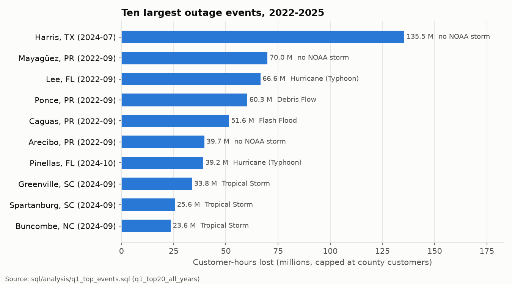
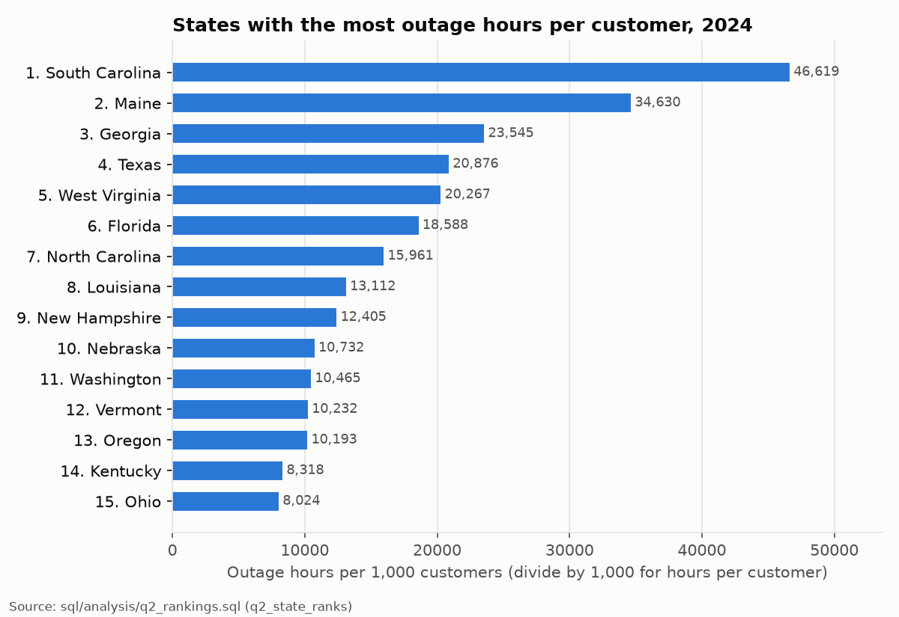
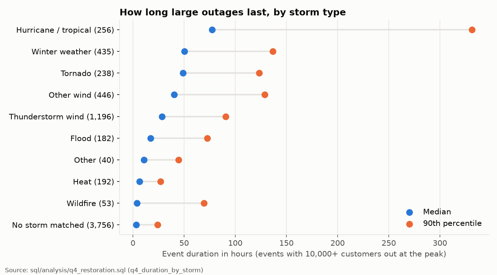
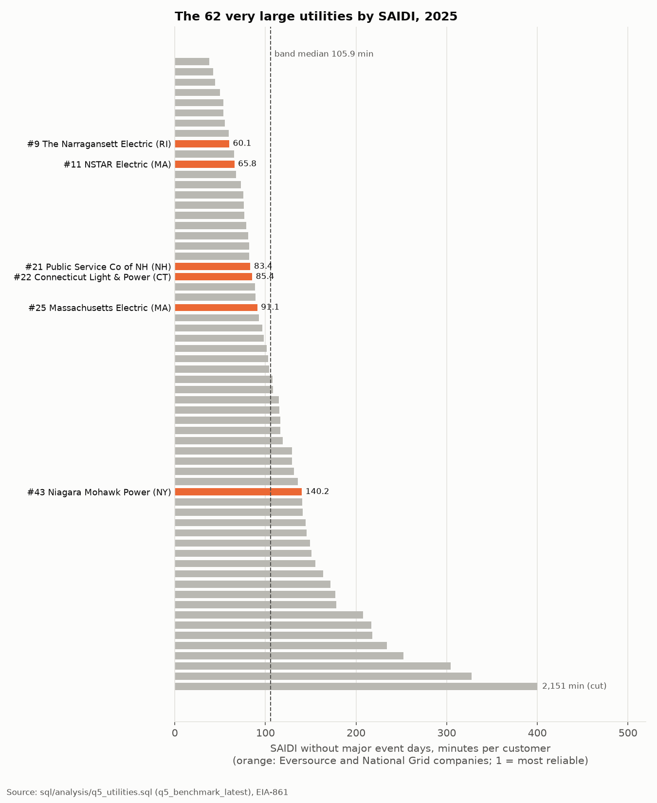
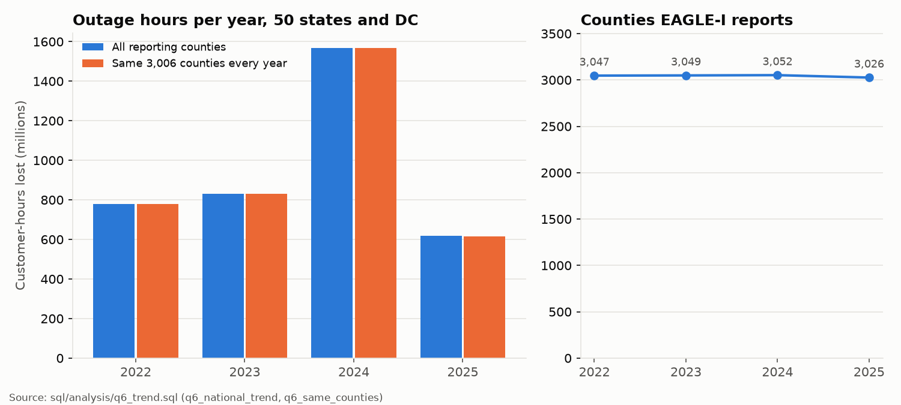

<!-- Rendered by scripts/analysis.py from docs/templates/findings.md. Edit the template, not docs/findings.md. -->
# Findings: US power outages and storm impact, 2022-2025

Every number on this page comes from a query in `sql/analysis/` run on the dbt marts in
Databricks. `scripts/analysis.py check` reruns the queries and fails if any number here no longer
matches (D68). The full results are in `docs/analysis_results/`.

**Read this first**
- **Event year:** an outage event counts in the year it starts (UTC), even when it runs into the
  next year. Customer-hours are never split across years.
- **Customer-hours** are capped at the county's customer count (D4). Rates are outage hours per
  1,000 customers; divide by 1,000 for hours per customer.
- **Puerto Rico** results are for PREPA's seven operating regions, filed under the FIPS code of
  each region's namesake municipio. They are not municipios (D22).
- **D61 restatement:** a county has rows only from its first reported year. This changed some
  published 2022-2023 ranks; the before and after values are in `CHANGELOG.md`.
- **OE-417** disturbance reports are loaded for 2022-2023 only (D25, D59).

## Q1. The largest outage events and their causes

| # | County | State | Start | Hours | Peak out | Customer-hours | Storm |
|---|---|---|---|---:|---:|---:|---|
| 1 | Harris | TX | 2024-07-08 | 255 | 1,660,703 | 135.5 M | unmatched |
| 2 | Mayagüez | PR | 2022-09-17 | 786 | 219,197 | 70.0 M | unmatched |
| 3 | Lee | FL | 2022-09-28 | 560 | 456,573 | 66.6 M | Hurricane (Typhoon) |
| 4 | Ponce | PR | 2022-09-18 | 742 | 210,593 | 60.3 M | Debris Flow |
| 5 | Caguas | PR | 2022-09-18 | 600 | 243,802 | 51.6 M | Flash Flood |
| 6 | Arecibo | PR | 2022-09-17 | 566 | 191,803 | 39.7 M | unmatched |
| 7 | Pinellas | FL | 2024-10-09 | 224 | 449,310 | 39.2 M | Hurricane (Typhoon) |
| 8 | Greenville | SC | 2024-09-27 | 307 | 270,050 | 33.8 M | Tropical Storm |
| 9 | Spartanburg | SC | 2024-09-27 | 300 | 183,816 | 25.6 M | Tropical Storm |
| 10 | Buncombe | NC | 2024-09-27 | 524 | 223,578 | 23.6 M | Tropical Storm |

- **Hurricane Beryl in Harris County TX is the largest event by far:**
  135.5 M customer-hours over
  255 hours, with
  1,660,703 customers out at the peak. NOAA places no
  Beryl event in Harris County, so the event shows as unmatched (D37). Hurricane Fiona in the
  Mayagüez and Arecibo regions is unmatched for the same reason: NOAA logs Fiona in Puerto Rico
  only as floods, debris flows and thunderstorm wind.
- **Tropical systems dominate the top 20:**
  8 of the 20 are hurricanes or
  tropical storms, and 6 have no NOAA
  match, Beryl and Fiona among them. Across all events, hurricanes and tropical storms cause
  18.1% of
  customer-hours from only 0.2%
  of events.
- **Most outages have no storm behind them:**
  87.8% of events and
  36.7% of
  customer-hours have no NOAA match.
- **Each year's largest event had a different cause:**
  - 2023: the Ice Storm in
    Wayne County
    MI
    (20.9 M).
  - 2025: the January High Wind in
    Los Angeles County
    CA
    (21.2 M, peak
    1,717,886 customers out).

## Q2. States and counties with the most outage hours per customer

Rank 1 state each year:
- 2022: Maine (19,716 hours per 1,000 customers)
- 2023: Maine (35,355)
- 2024: South Carolina (46,619)
- 2025: West Virginia (16,592)

| Rank 2024 | State | Region | Hours per 1k | Customer-hours | Events |
|---|---|---|---:|---:|---:|
| 1 | South Carolina | South | 46,619 | 139.8 M | 3,129 |
| 2 | Maine | Northeast | 34,630 | 30.7 M | 1,760 |
| 3 | Georgia | South | 23,545 | 126.2 M | 8,982 |
| 4 | Texas | South | 20,876 | 314.4 M | 13,602 |
| 5 | West Virginia | South | 20,267 | 20.1 M | 3,724 |
| 6 | Florida | South | 18,588 | 260.8 M | 5,322 |
| 7 | North Carolina | South | 15,961 | 113.6 M | 5,788 |
| 8 | Louisiana | South | 13,112 | 34.3 M | 5,453 |
| 9 | New Hampshire | Northeast | 12,405 | 10.0 M | 860 |
| 10 | Nebraska | Midwest | 10,732 | 10.5 M | 461 |

Counties, top 3 per year:

| Year | Rank | County | State | Hours per 1k | Customers |
|---|---|---|---|---:|---:|
| 2022 | 1 | Charlotte | FL | 123,103 | 137,611 |
| 2022 | 2 | Franklin | VA | 114,868 | 5,533 |
| 2022 | 3 | Lee | FL | 102,091 | 668,566 |
| 2023 | 1 | Austin | TX | 117,505 | 10,181 |
| 2023 | 2 | Marion | TX | 115,955 | 7,743 |
| 2023 | 3 | Mono | CA | 115,687 | 5,586 |
| 2024 | 1 | Yancey | NC | 497,902 | 7,907 |
| 2024 | 2 | Mitchell | NC | 387,703 | 8,839 |
| 2024 | 3 | Atkinson | GA | 352,557 | 4,952 |
| 2025 | 1 | Montmorency | MI | 338,917 | 7,909 |
| 2025 | 2 | Oscoda | MI | 262,986 | 5,072 |
| 2025 | 3 | Presque Isle | MI | 208,245 | 9,040 |

- **Hurricane Helene put western North Carolina at the top of the 2024 county list:**
  Yancey County
  (497,902 hours per 1,000
  customers) and Mitchell County are ranks 1 and 2.
  South Carolina is the top state that year.
- **Maine is at or near the top every year to 2024:** rank
  1 in 2022,
  1 in 2023 and
  2 in 2024. In 2025 it fell to
  13.
- **Austin County TX:**
  - It is rank 1 in 2023
    (117,505 hours per 1,000 customers). It passed
    the D46 misattribution test and stays ranked: a small county
    (10,181 customers) next to Houston, whose rate reflects
    Houston-area storms.
  - In 2024 it is footnoted by D45, because most of its customer-hours came from capped readings.
- **Possible misattributions:** 39 counties outside the
  calibrated states have a 2022-2024 peak above 1.25x their customers. Their readings are flagged
  and capped (D4), not floored. When D36 was written the list had 30 counties; the same rule on
  today's marts finds the count above. The largest ratios:

| County | State | Customers | Peak out | Peak / customers |
|---|---|---:|---:|---:|
| Austin | TX | 10,181 | 126,963 | 12.47 |
| Cochise | AZ | 81,291 | 718,642 | 8.84 |
| Waller | TX | 19,624 | 121,248 | 6.18 |
| Sioux | NE | 660 | 2,936 | 4.45 |
| Rich | UT | 1,005 | 3,980 | 3.96 |
| McMullen | TX | 222 | 760 | 3.42 |
| Hamilton | NY | 2,566 | 7,289 | 2.84 |
| Madison | NC | 5,801 | 15,310 | 2.64 |

- **Connecticut 2025 is footnoted, not ranked:** from 2025-05-29 EAGLE-I reports it by planning
  region, and those regions have no customer denominator (D60). 2025 therefore ranks
  50 states instead of
  51.
- **After the D61 restatement,** Mississippi is rank
  17 in 2022 and
  10 in 2023.

## Q3. Regions and the storms that cost them the most

The storm families with at least 10% of a region's customer-hours (50 states and DC):

| Region | Storm family | Events | Customer-hours | Share of region | Hours per 1k per year |
|---|---|---:|---:|---:|---:|
| Midwest | Thunderstorm wind | 5,894 | 207.4 M | 30% | 1,462 |
| Midwest | No storm matched | 101,642 | 200.8 M | 29% | 1,416 |
| Midwest | Winter weather | 3,615 | 149.5 M | 22% | 1,054 |
| Midwest | Tornado | 1,026 | 100.9 M | 15% | 711 |
| Northeast | No storm matched | 64,258 | 133.7 M | 32% | 1,267 |
| Northeast | Winter weather | 2,379 | 92.4 M | 22% | 876 |
| Northeast | Thunderstorm wind | 2,704 | 91.4 M | 22% | 867 |
| Northeast | Other wind | 1,205 | 74.9 M | 18% | 711 |
| South | Hurricane / tropical | 1,202 | 763.9 M | 35% | 2,665 |
| South | No storm matched | 288,181 | 728.5 M | 34% | 2,542 |
| South | Thunderstorm wind | 14,437 | 324.0 M | 15% | 1,130 |
| West | No storm matched | 61,362 | 210.2 M | 40% | 1,513 |
| West | Other wind | 2,486 | 167.5 M | 32% | 1,206 |
| West | Winter weather | 4,494 | 76.5 M | 15% | 551 |

- **The South's outages are hurricane outages:** tropical systems account for
  35%
  of its customer-hours. That is
  2,665
  hours per 1,000 customers a year, more than any other region loses to any one storm family.
- **The Midwest is a thunderstorm region:** thunderstorm wind causes
  30%
  of its customer-hours and tornadoes
  15%.
- **In the Northeast no single storm family dominates:**
  - winter weather 22%;
  - thunderstorm wind 22%;
  - other wind 18%.
- **In the West, wind is the cause**
  (32% of its
  customer-hours), and wildfire is not. Wildfire-matched outages in the West total
  5.3 M in
  2024. Wildfire shutoffs happen in high wind, so NOAA most likely records those days as wind
  events.
- **Texas winter weather was a 2023 story:**
  25.2 M
  customer-hours that year, against
  0.3 M
  in 2024.
- **Gulf Coast hurricanes:**
  181.9 M
  in 2022 (Ian) and
  221.7 M
  in 2024. No 2025 event in the Gulf states matched a tropical storm.

## Q4. Which storms take longest to restore

| Storm family | Events | Median h (all) | Events 10k+ | Median h (10k+) | P90 h (10k+) |
|---|---:|---:|---:|---:|---:|
| Hurricane / tropical | 1,231 | 6.5 | 256 | 77.4 | 331 |
| Winter weather | 14,520 | 2.8 | 435 | 50.5 | 137 |
| Tornado | 3,119 | 8.2 | 238 | 48.9 | 123 |
| Other wind | 7,369 | 3.8 | 446 | 40.3 | 129 |
| Thunderstorm wind | 24,026 | 5.0 | 1,196 | 28.4 | 91 |
| Flood | 8,047 | 2.2 | 182 | 17.3 | 73 |
| Other | 3,114 | 2.2 | 40 | 10.8 | 44 |
| Heat | 8,637 | 1.5 | 192 | 6.5 | 27 |
| Wildfire | 3,265 | 1.8 | 53 | 3.8 | 70 |
| No storm matched | 529,027 | 1.5 | 3,756 | 3.3 | 24 |

- **Most outages are short:** the median event lasts
  1.5 hours when no storm is
  matched and 5.0 hours in
  thunderstorm wind. The large outages (10,000+ customers out) are the ones that last.
- **Large outages last longest after tropical systems:** median
  77 hours, with
  one in ten lasting over 331
  hours. Next come winter weather
  (50 h) and tornadoes
  (49 h). Large
  thunderstorm-wind outages restore in about a day
  (28 h).
- **Large outages last longest in the Midwest and Northeast:**

| Region | Events | Median h (all) | Events 10k+ | Median h (10k+) | P90 h (10k+) |
|---|---:|---:|---:|---:|---:|
| Midwest | 116,169 | 1.5 | 797 | 29.5 | 104 |
| Northeast | 72,165 | 1.5 | 726 | 25.6 | 86 |
| South | 324,349 | 1.5 | 2,249 | 15.5 | 108 |
| Territory | 14,775 | 2.2 | 1,618 | 6.8 | 27 |
| West | 74,897 | 1.5 | 1,404 | 4.0 | 58 |

  The median large outage lasts
  30 hours in the Midwest
  and 26 in the Northeast,
  against 4 in the West.

## Q5. Utility reliability: Eversource and National Grid against their peers

SAIDI and SAIFI come from EIA-861, IEEE 1366 reporters only, ranked within size band (1 = most
reliable, D39). Figures exclude major event days.

| Parent | Utility | State | Band | SAIDI min | Rank | Of | vs band median | SAIFI |
|---|---|---|---|---:|---|---|---:|---:|
| Eversource | Connecticut Light & Power Co | CT | very_large | 85.4 | 22 | 62 | 0.81 | 0.69 |
| Eversource | NSTAR Electric Company | MA | very_large | 65.8 | 11 | 62 | 0.62 | 0.66 |
| Eversource | Public Service Co of NH | NH | very_large | 83.4 | 21 | 62 | 0.79 | 0.74 |
| National Grid | Massachusetts Electric Co | MA | very_large | 91.1 | 25 | 62 | 0.86 | 0.84 |
| National Grid | Nantucket Electric Co | MA | medium | 102.6 | 219 | 498 | 0.90 | 0.97 |
| National Grid | Niagara Mohawk Power Corp. | NY | very_large | 140.2 | 43 | 62 | 1.32 | 1.11 |
| National Grid (sold to PPL in May 2022) | The Narragansett Electric Co | RI | very_large | 60.1 | 9 | 62 | 0.57 | 0.73 |

- **All three Eversource companies beat the very-large-band median in 2025**
  (105.9 minutes).
  NSTAR Electric is best at rank
  11
  of 62
  (65.8
  minutes).
- **National Grid's Niagara Mohawk (NY) is the weak spot:** rank
  43
  of 62,
  1.32x
  the band median. It ranks
  45
  in 2022, 43
  in 2023 and 43
  in 2024. National Grid's Massachusetts Electric is near the median
  (0.86x).
- **Two caveats:**
  - Narragansett Electric (RI) ranks
    9,
    but National Grid sold it to PPL in May 2022.
  - NSTAR's 2023 row is unranked: "source row repeats the values of another utility"
    (D39). Its 2023 values repeat those of Connecticut Light & Power.

## Q6. The 2022-2025 trend, and why it is not a coverage effect

| Year | Events | Customer-hours | Counties reporting | Hours per 1k | vs 2022 |
|---|---:|---:|---:|---:|---:|
| 2022 | 146,220 | 780.3 M | 3,047 | 4,643 | 1.00 |
| 2023 | 141,086 | 831.0 M | 3,049 | 4,944 | 1.06 |
| 2024 | 147,904 | 1,566.9 M | 3,052 | 9,317 | 2.01 |
| 2025 | 152,370 | 618.5 M | 3,026 | 3,685 | 0.79 |

Hours per 1k are per 1,000 customers of the reporting counties.

The same 3,006 counties, reported in every year:

| Year | Events | Customer-hours | Hours per 1k | vs 2022 |
|---|---:|---:|---:|---:|
| 2022 | 146,134 | 780.2 M | 4,651 | 1.00 |
| 2023 | 140,968 | 830.9 M | 4,953 | 1.06 |
| 2024 | 147,760 | 1,566.7 M | 9,340 | 2.01 |
| 2025 | 150,931 | 615.5 M | 3,670 | 0.79 |

- **2024 was the worst year, and not because of coverage:** customer-hours were
  2.01x the 2022 level. On the same counties
  every year the ratio is 2.01x, so the increase
  happened in counties that were already reported. It came from storms: Beryl, Helene and Milton
  are all in the 2024 top 10 (Q1).
- **Coverage was flat over the period:**
  - EAGLE-I reports 3,047 counties in 2022
    and 3,026 in 2025.
  - Only 15 counties are first reported
    in 2025 (38,616 customers).
  - 2025 is the lowest year: 0.79x 2022. No
    Gulf Coast event matched a tropical storm that year (Q3).
- **Coverage did grow before 2022, which is why the series starts there:** EAGLE-I's published
  coverage of customers in the 50 states and DC rose from
  87.6% in 2018 to
  92.2% in 2022. Its data quality index
  (mean of the ten FEMA regions) rose from 70.1 to
  86.4. The release publishes neither after 2022,
  so the same-county comparison above is the check for later years (D67).

