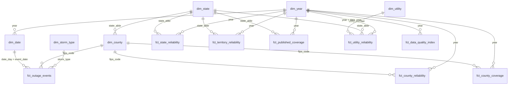

# Power BI data model

I build the dashboard by hand in Power BI Desktop from the dbt marts (D66). They are exported by
`make export` (D70). This page lists what to load, how the tables relate, what to hide and how to
check the load. The measures are in [measures.md](measures.md), the pages in
[dashboard_plan.md](dashboard_plan.md), and every column is described in
[../docs/data_dictionary.md](../docs/data_dictionary.md).

## Files to load

| Table | File | Role |
|---|---|---|
| `dim_year` | `data/gold_exports/summary/dim_year.csv` | Year slicer (2018-2025) |
| `dim_date` | `data/gold_exports/summary/dim_date.csv` | Calendar of the reading years |
| `dim_state` | `data/gold_exports/summary/dim_state.csv` | States, DC, PR, VI; Census and FEMA regions |
| `dim_county` | `data/gold_exports/summary/dim_county.csv` | Counties and PR operating regions, with denominators |
| `dim_storm_type` | `data/gold_exports/summary/dim_storm_type.csv` | NOAA event types and storm groups |
| `dim_utility` | `data/gold_exports/summary/dim_utility.csv` | EIA-861 utilities; Eversource / National Grid flag |
| `fct_outage_events` | `data/gold_exports/release/fct_outage_events.parquet` | One row per outage event (the GitHub Release file) |
| `fct_state_reliability` | `data/gold_exports/summary/fct_state_reliability.csv` | State-year rates and ranks |
| `fct_county_reliability` | `data/gold_exports/summary/fct_county_reliability.csv` | County-year rates, ranks, footnotes |
| `fct_territory_reliability` | `data/gold_exports/summary/fct_territory_reliability.csv` | PR and VI per year, never ranked |
| `fct_utility_reliability` | `data/gold_exports/summary/fct_utility_reliability.csv` | SAIDI / SAIFI per utility, state, year |
| `fct_county_coverage` | `data/gold_exports/summary/fct_county_coverage.csv` | Readings per county and year |
| `fct_published_coverage` | `data/gold_exports/summary/fct_published_coverage.csv` | EAGLE-I published coverage, 2018-2022 |
| `fct_data_quality_index` | `data/gold_exports/summary/fct_data_quality_index.csv` | EAGLE-I DQI per FEMA region, 2018-2022 |

The row counts, column types and SHA-256 of every file are in
`data/gold_exports/summary/manifest.json`. Times are UTC. An event counts in the year it starts.

## Star schema

Every relationship is many-to-one from the fact to the dimension, with a single filter direction
(the dimension filters the fact). Facts never filter each other. Two dimensions snowflake:
`dim_state` filters `dim_county`, and `dim_year` filters `dim_date`. The state and year of a
county-grain or event-grain fact therefore come through `dim_county` and `dim_date`, which keeps
every filter path unique.



| # | From (many) | To (one) | Cardinality | Cross-filter |
|---|---|---|---|---|
| 1 | `dim_date[year]` | `dim_year[year]` | many-to-one | single |
| 2 | `dim_county[state_abbr]` | `dim_state[state_abbr]` | many-to-one | single |
| 3 | `fct_outage_events[event_date]` | `dim_date[date_day]` | many-to-one | single |
| 4 | `fct_outage_events[fips_code]` | `dim_county[fips_code]` | many-to-one | single |
| 5 | `fct_outage_events[storm_type]` | `dim_storm_type[storm_type]` | many-to-one | single |
| 6 | `fct_county_reliability[fips_code]` | `dim_county[fips_code]` | many-to-one | single |
| 7 | `fct_county_reliability[year]` | `dim_year[year]` | many-to-one | single |
| 8 | `fct_county_coverage[fips_code]` | `dim_county[fips_code]` | many-to-one | single |
| 9 | `fct_county_coverage[year]` | `dim_year[year]` | many-to-one | single |
| 10 | `fct_state_reliability[state_abbr]` | `dim_state[state_abbr]` | many-to-one | single |
| 11 | `fct_state_reliability[year]` | `dim_year[year]` | many-to-one | single |
| 12 | `fct_territory_reliability[state_abbr]` | `dim_state[state_abbr]` | many-to-one | single |
| 13 | `fct_territory_reliability[year]` | `dim_year[year]` | many-to-one | single |
| 14 | `fct_published_coverage[state_abbr]` | `dim_state[state_abbr]` | many-to-one | single |
| 15 | `fct_published_coverage[year]` | `dim_year[year]` | many-to-one | single |
| 16 | `fct_utility_reliability[utility_number]` | `dim_utility[utility_number]` | many-to-one | single |
| 17 | `fct_utility_reliability[state_abbr]` | `dim_state[state_abbr]` | many-to-one | single |
| 18 | `fct_utility_reliability[data_year]` | `dim_year[year]` | many-to-one | single |
| 19 | `fct_data_quality_index[year]` | `dim_year[year]` | many-to-one | single |

Notes on the keys:
- I do not relate the event and county facts' own `state_abbr` to `dim_state`. A second path to
  `dim_state` would make the model ambiguous, and `dim_county` already carries the state.
- `fct_data_quality_index` is per FEMA region. FEMA region is not unique in `dim_state`, so the
  table relates only to `dim_year`. Slice it with its own `fema_region` column.
- `fct_utility_reliability` has 9 rows for AS, GU and MP, which `dim_state` does not cover
  (D66). Power BI puts them under the blank state. I filter `dim_state[state_abbr]` to non-blank on
  the utility page.
- Turn off auto-detected relationships (File > Options > Current file > Data load) and create the
  19 above by hand. Auto-detect would join the facts' `state_abbr` and `customers` columns.

## Columns to hide

The measures read these columns, but report users should not drag them into visuals: they are
keys, duplicates of a dimension column, or pipeline internals.

| Table | Hide |
|---|---|
| all facts | Every key: `*_key`, `fips_code`, `state_abbr`, `year` / `data_year`, `event_date`, `utility_number`, `storm_type` |
| `fct_outage_events` | `event_year` (use `dim_year`), `storm_tier` (use `dim_storm_type`), `customer_hours_lost_raw`, `event_threshold`, `reading_count`, `customers`, `denominator_source`, `has_denominator`, `most_severe_storm_type`, `candidate_storms`, `attribution_rule`, and every measure input (`customer_hours_lost`, `duration_hours`) |
| `fct_county_reliability` | `customers`, `customer_hours_lost`, `capped_customer_hours`, `rank_without_footnotes`, `ranking_eligible`; keep `footnote_reason` and `footnote_evidence` for tooltips |
| `fct_state_reliability` | `customers`, `customer_hours_lost`, `eaglei_counties`, `total_counties`, `ranking_eligible` |
| `fct_utility_reliability` | `utilities_in_band`, `customers`; keep the SAIDI / SAIFI columns visible for the benchmark table |
| `dim_county` | `state_name`, `census_region`, `fema_region` (use `dim_state`), `denominator_source`, `denominator_mismatch`, `calibration_factor`, `state_calibration_factor`, `peak_floor_applied`, `peak_floor_skipped`, `base_peak_customers_out` |
| `dim_state` | `state_fips`, `calibration_factor`, `eaglei_customers`, `eia_customers` |
| `dim_date` | `date_key`, `year` (use `dim_year`) |
| `dim_storm_type` | `severity_rank`, `can_cause_outage` |

Sort `dim_date[month_start]` by itself and `dim_storm_type[storm_group]` alphabetically, with
"No storm matched" last. One way: a calculated column `storm_group_order` that is 99 for that group
and 1 for the rest, used as the sort-by column.

## Loading the files

### Summary CSV files

1. File > Options > Current file > Data load: set "Type detection" to "Never detect". Otherwise Power
   BI reads `fips_code` "06037" as the number 6037 and the joins break.
2. Create a text parameter `ExportRoot`: the full path to `data/gold_exports` in my clone. To read
   straight from GitHub instead, use
   `https://raw.githubusercontent.com/Deva9102/us-grid-outage-analytics/main/data/gold_exports` with
   `Web.Contents` in place of `File.Contents`.
3. For each CSV, Get Data > Blank query > Advanced editor, then set the types from `manifest.json`.
   Codes and keys (`fips_code`, `state_fips`, `utility_number`, `event_id`, `*_key`) are text.
   `true`/`false` columns are logical:

```powerquery
let
    Source = Csv.Document(
        File.Contents(ExportRoot & "\summary\dim_county.csv"),
        [Delimiter = ",", Encoding = 65001, QuoteStyle = QuoteStyle.Csv]),
    Headers = Table.PromoteHeaders(Source, [PromoteAllScalars = true]),
    Typed = Table.TransformColumnTypes(Headers, {
        {"fips_code", type text}, {"county", type text}, {"state_abbr", type text},
        {"customers", Int64.Type}, {"has_denominator", type logical},
        {"is_calibrated", type logical}, {"first_reported_year", Int64.Type}
        // ... the remaining columns, typed as in manifest.json
    }, "en-US")
in
    Typed
```

Empty fields are NULL. Pass the "en-US" culture so decimals read with a point on any locale.

### fct_outage_events (Parquet)

The large table is not in git. It is a GitHub Release asset (D70) and is also written locally to
`data/gold_exports/release/` by `make export`.

1. Get Data > Parquet. Paste the local path or the release asset URL
   `https://github.com/Deva9102/us-grid-outage-analytics/releases/download/data-2026-11-23/fct_outage_events.parquet`.
2. The same in M:

```powerquery
let
    Source = Parquet.Document(File.Contents(ExportRoot & "\release\fct_outage_events.parquet"))
in
    Source
```

Parquet carries the types: text keys, whole numbers, decimals, `event_date` as a date, and the
UTC timestamps as plain datetimes. Only `overlap_hours`, a fixed decimal, may need setting to
Decimal number. Check the file against the SHA-256 in `manifest.json` first:
`shasum -a 256 fct_outage_events.parquet`.

## Checks after loading

- The row count of every table equals `rows` in `manifest.json`.
- With `dim_state[is_ranked_jurisdiction] = TRUE`, [Customer Hours Lost] and [Number of Events] by
  `dim_year[year]` equal `customer_hours_lost` and `events` in
  `docs/analysis_results/q6_national_trend.csv`.
- [Outage Hours per 1k Customers] by state for a year equals `outage_hours_per_1000` in
  `docs/analysis_results/q2_state_ranks.csv`.
- [Utility SAIDI vs Peer Median] on an Eversource or National Grid row equals `saidi_vs_median` in
  `docs/analysis_results/q5_eversource_national_grid.csv`.
